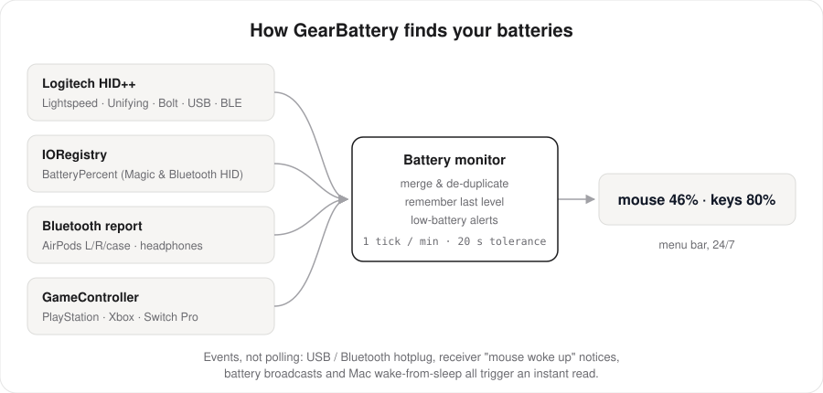

<p align="center">
  
</p>

<p align="center">
  <a href="https://github.com/Narmberto/GearBattery/releases/latest"></a>
  
  
</p>

**GearBattery** detects the battery-powered hardware connected to your Mac and keeps each device's charge level in the menu bar, all the time. Connect a wireless mouse, keyboard, headset or controller and it shows up on its own, e.g. `43%`. You don't set anything up and don't pick devices from a list.

<p align="center">
  <br>
  
</p>

<sub>Left: a wireless mouse that is asleep (dimmed, last known level). Middle: a keyboard at 12%; the item turns red when a device is low. Right: earbuds while charging.</sub>

---

## Features

- **Automatic hardware detection.** Every connected device that reports a battery is found and shown, by the name the device itself reports.
- **Reads the real level.** The percentage comes from the device, not from an estimate.
- **In the menu bar 24/7.** It starts at login and restarts itself if it ever crashes.
- **Plug and play.** Devices appear the moment they connect and disappear when removed.
- **Sleeping devices stay visible.** A device that powers down to save battery stays in the bar, dimmed, with its last known level.
- **Low-battery alert** at 15%, as a notification and a red menu bar item.
- **Choose what's shown:** all devices, or pin just one.
- **Efficient:** event-driven, 0.0% CPU when idle.

## What it detects

| Connection | Examples |
|---|---|
| **Bluetooth** | Mice, keyboards, trackpads |
| **Bluetooth audio** | Earbuds (left / right / case), headphones, headsets |
| **Wireless USB receivers** | Mice and keyboards on a USB dongle that uses the HID++ protocol |
| **USB cable** | Wireless devices plugged in to charge |
| **Game controllers** | Any controller macOS supports |

A device has to report its battery level to macOS. A few gaming dongles use closed protocols that don't, so those can't be read yet.

## Install

1. Download **`GearBattery-1.0.0.dmg`** from [**Releases**](https://github.com/Narmberto/GearBattery/releases/latest).
2. Open it and double-click **Install GearBattery.pkg**.
3. The cat appears in your menu bar, followed by your devices.

> GearBattery is not notarized by Apple. If macOS says it "can't verify the developer", right-click the `.pkg` and choose **Open**, or allow it under **System Settings → Privacy & Security**.
>
> If you don't see the item, check **System Settings → Menu Bar** and make sure GearBattery is allowed.

## How it works

<p align="center">
  
</p>

| What | How |
|---|---|
| Finding devices | No scanning: macOS notifies the app when hardware connects or disconnects. |
| Devices waking up | Receivers report when a device wakes, so its battery is read right away. A sleeping device costs nothing. |
| Periodic refresh | One timer a minute that macOS can batch with other work. Batteries are re-read every 5 minutes. |
| After sleep | Everything is re-read a few seconds after the Mac wakes up. |
| Measured | **0.0% CPU** idle, ~45 MB RAM. |

## About

Click the menu bar item → **About GearBattery** to meet the mascot:

```
 /\_/\
( o.o )
 > ^ <
[####-]
```

## Troubleshooting

To see which devices GearBattery detects, run:

```bash
/Applications/GearBattery.app/Contents/MacOS/GearBattery --probe
```

It prints one line per device:

```
<device name> | <level> | <connection>
```

## Uninstall

Double-click **Uninstall GearBattery.command** on the disk image, or run:

```bash
sudo /Applications/GearBattery.app/Contents/Resources/uninstall.sh
```

---

<sub>© 2026 Narmberto</sub>
