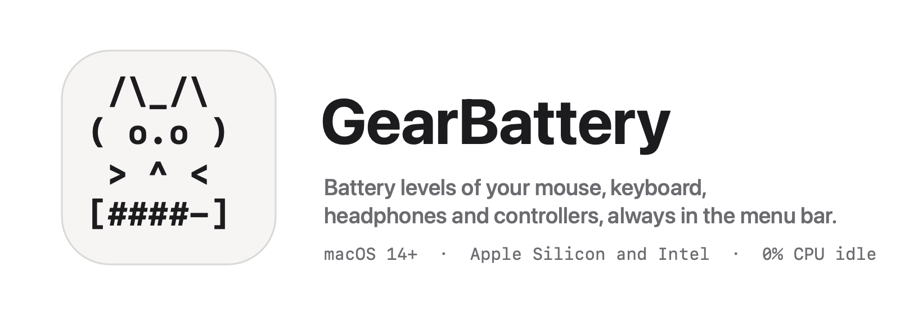
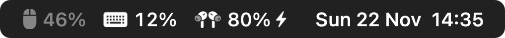

<p align="center">
  
</p>

<p align="center">
  <a href="https://github.com/Narmberto/GearBattery/releases/latest"></a>
  
  
</p>

**GearBattery** is a small macOS menu bar app that always shows how much charge your wireless gear has left. For example, it tells you your G Pro mouse is at 46% before it dies in the middle of a game.

<p align="center">
  <br>
  
</p>

<sub>Left: a Logitech PRO X 2 that is asleep (dimmed, last known level). Middle: a keyboard at 12%; the item turns red when a device is low. Right: AirPods while charging.</sub>

---

## Features

- **Real hardware detection.** It reads the battery from the device itself; no guessing from a vendor app.
- **In the menu bar 24/7.** It starts at login and restarts itself if it ever crashes.
- **Sleeping devices stay visible.** A wireless mouse that dozes off stays in the bar, dimmed, with its last known level.
- **Low-battery alert** at 15%, as a notification and a red menu bar item.
- **Choose what's shown:** all devices, or pin just one (e.g. only your mouse).
- **Efficient:** event-driven, 0.0% CPU when idle.

## Supported devices

| Type | Devices | How the battery is read |
|---|---|---|
| **Logitech** | G Pro, G Pro X Superlight 1/2, G502/G305 Lightspeed, MX Master/Anywhere, MX Keys, on **Lightspeed, Unifying or Bolt** receivers, USB cable, or Bluetooth | Logitech's HID++ 2.0 protocol |
| **Bluetooth** | Apple Magic Mouse / Keyboard / Trackpad, most Bluetooth LE mice and keyboards | Battery level reported by macOS |
| **Audio** | AirPods (left / right / case), Beats, Bluetooth headphones | macOS Bluetooth report |
| **Controllers** | PlayStation, Xbox, Switch Pro, MFi | Apple's GameController framework |

> Razer, Corsair and SteelSeries wireless receivers use private protocols and aren't supported yet.

## Install

1. Download **`GearBattery-1.0.0.dmg`** from [**Releases**](https://github.com/Narmberto/GearBattery/releases/latest).
2. Open it and double-click **Install GearBattery.pkg**.
3. The cat appears in your menu bar. That's it.

> GearBattery is not notarized by Apple. If macOS says it "can't verify the developer", right-click the `.pkg` and choose **Open**, or allow it under **System Settings → Privacy & Security**.
>
> If you don't see the item, check **System Settings → Menu Bar** and make sure GearBattery is allowed.

## How it works

<p align="center">
  
</p>

| What | How |
|---|---|
| Finding devices | No scanning: macOS notifies the app when a device connects or disconnects. |
| Logitech mouse waking up | The receiver reports it, so the battery is read the moment you move the mouse. A sleeping mouse costs nothing. |
| Periodic refresh | One timer a minute that macOS can batch with other work. Batteries are re-read every 5 minutes. |
| After sleep | Everything is re-read a few seconds after the Mac wakes up. |
| Measured | **0.0% CPU** idle, ~45 MB RAM. |

## About

Click the menu bar item → **About GearBattery** to meet the mascot:

```
 /\_/\
( o.o )
 > ^ <
[####-]
```

## Troubleshooting

To see which devices GearBattery detects, run:

```bash
/Applications/GearBattery.app/Contents/MacOS/GearBattery --probe
```

The output looks like this:

```
PRO X 2 | 46% | Logitech · wireless receiver
```

## Uninstall

Double-click **Uninstall GearBattery.command** on the disk image, or run:

```bash
sudo /Applications/GearBattery.app/Contents/Resources/uninstall.sh
```

---

<sub>© 2026 Narmberto</sub>
